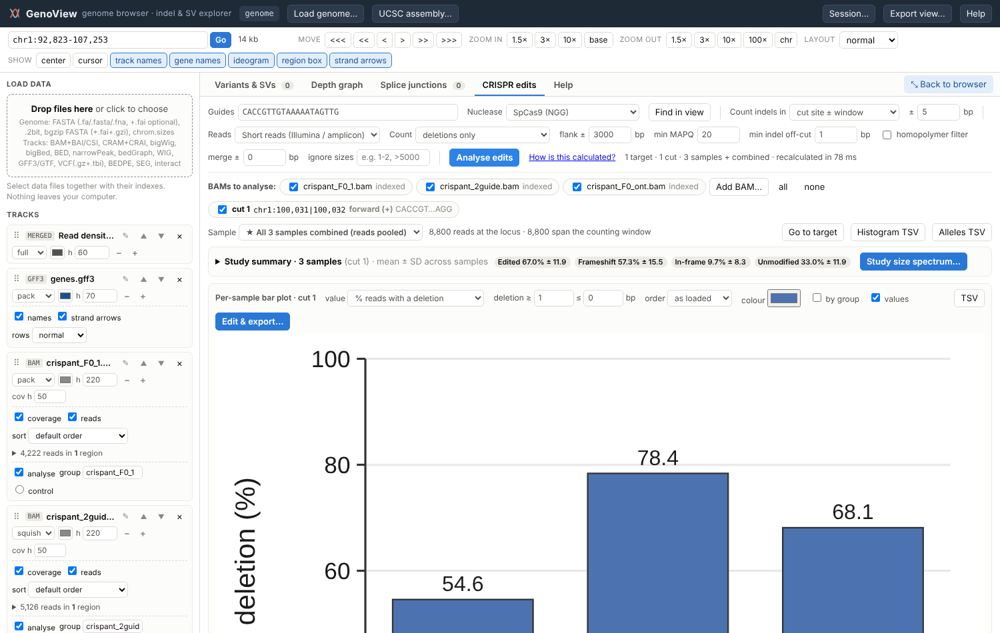
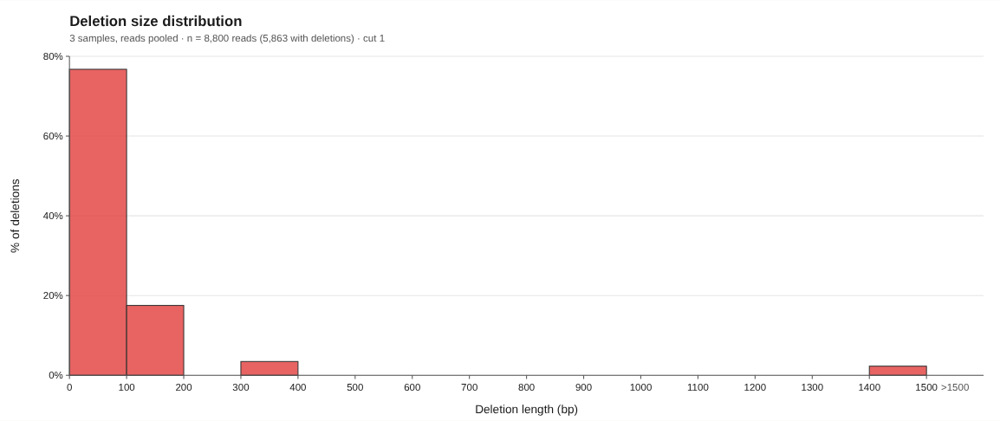
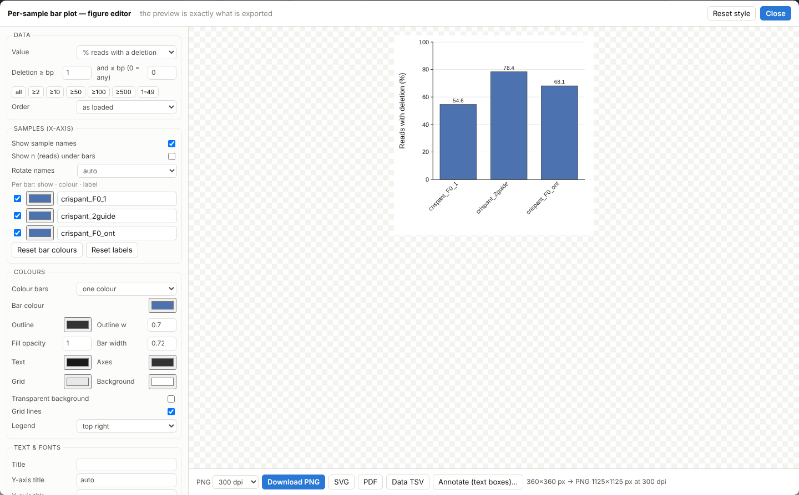

# GenoView

GenoView is a single-file, offline genome browser in the style of IGV and UCSC. It is built for **viewing your own genome and sequencing data, finding indels and structural variants, and measuring CRISPR edits in individual crispants (G0 animals) from short or long reads**.

Everything runs in your browser, with nothing to install and no server. Your files never leave your computer.



## Quick start

1. Download `index.html`, or clone the repository.
2. Open it in Chrome, Edge or Firefox.
3. Drop your files onto the page: a genome FASTA (with its `.fai`), plus BAM files with their `.bai` index and any other tracks.

To try it, drop the files in [`example/`](example/). Then open the **CRISPR edits** tab, enter the guide `CACCGTTGTAAAAATAGTTG` and press **Analyse edits**.

You can also put it online with GitHub Pages: *Settings → Pages → Deploy from branch → `main` / root*. The browser will then be available at `https://<user>.github.io/<repo>/`. It still runs entirely in the browser, and the data is never uploaded.

## What it does

**Genome browser**
- Tracks:
  - genome: FASTA (plain or bgzip), 2bit, chrom.sizes;
  - reads: BAM/CRAM, with or without an index;
  - signal and annotation: bigWig, bigBed, BED, narrowPeak, bedGraph, WIG, GFF3/GTF, VCF, BEDPE, SEG, interact.
- Merged read-density track, so you can see where the reads are at any zoom level.
- Track controls:
  - rename, reorder (drag or ▲▼) and resize tracks;
  - hide coverage or reads;
  - compact layouts;
  - hide gene names and strand arrows;
  - sort reads by deletion size or randomly.
- Export the view as PNG (any dpi), SVG or PDF, with text boxes, arrows, cropping and guide or region highlights.
- Sessions: save and reopen everything as a small `.genoview.json` file. Sessions work across versions.

**Variants and SVs**
- Small indels and structural variants: deletions, duplications, inversions, translocations and insertions.
- Detected from CIGARs, split reads, discordant pairs, soft clips and read depth, with depth graphs and merged BAMs.

**CRISPR crispant analysis (per sample, no control needed)**
- Guides:
  - one or several guides on either strand, or cut positions;
  - SpCas9, NG, SpRY, SaCas9 and Cas12a PAMs.
- Short reads (Illumina, amplicon) or long reads (ONT, PacBio). Long reads are detected automatically and long-read error filters are applied.
- Count **indels** or **deletions only**. In deletions-only mode the size distribution is given as **% of deletions (sums to 100%)**.
- Results:
  - alleles with sequence alignments;
  - frameshift and in-frame classes;
  - large deletions, including split-read deletions;
  - dropouts between two cuts;
  - mosaicism.
- Leave out inherited polymorphisms (⊘) or chosen sizes. Restrict counting to regions of interest.
- **Size distribution** (continuous histogram) for each sample or the whole dataset: reads pooled, or mean ± SD of samples.
- **Per-sample bar plot** of % reads with a deletion. You can set a deletion-size threshold (e.g. ≥ 50 bp).
- Every figure is fully editable: labels (including hiding the sample names), colours, fonts, sizes and axes. Export as PNG (150–1200 dpi), SVG, PDF or TSV.

**Help → "How the size distribution is calculated"** explains exactly which reads and events are counted and how each percentage is computed.




## Python scripts (`scripts/`)

All three need Python 3 plus these packages:
- `verify_spectrum.py`: `pysam`
- `deletion_barplot.py`: `pysam` and `matplotlib`
- `deletion_stats.py`: `numpy`, `pandas` and `scipy` (`statsmodels` optional, for the clustered models)

| Script | What it does |
|---|---|
| `verify_spectrum.py` | Recalculates the deletion/indel size distribution independently from BAMs, using the same counting rules as GenoView, so you can check GenoView's numbers. Run it with GenoView's homopolymer filter, ⊘ masks and *ignore sizes* off. |
| `deletion_barplot.py` | Gives the % of reads carrying a deletion at a cut site for each BAM, as a table plus a bar plot (PNG/SVG/PDF). Supports `--min-del` / `--max-del`. |
| `deletion_stats.py` | Statistics on deletion-size distributions from GenoView *Alleles TSV* exports. It summarises each sample, then compares groups with the sample (animal), not the read, as the unit. |

Example:

```bash
python scripts/verify_spectrum.py --cut 100031 --window 10 --flank 10000 --min-indel 3 --kinds D example/crispant_F0_ont.bam
python scripts/deletion_barplot.py --cut chr1:100031 example/*.bam -o deletion_pct
```

`--cut` uses GenoView's cut coordinate, so copy the number shown next to the cut site in the CRISPR tab.

## Example data (`example/`)

All files are **simulated**. The genome, genes, reads and edits are synthetic, so no real data are included.

| File | Contents |
|---|---|
| `genome.fa`, `.fai` | Synthetic reference genome |
| `genes.gff3`, `genes.bed` | Synthetic gene annotation |
| `crispant_F0_1.bam`, `crispant_F0_2.bam` | Short-read crispants with known allele mixes (guide 1, cut at chr1:100,031) |
| `crispant_2guide.bam` | Two guides (cuts at 100,031 and 100,198), including dropout deletions and an inherited 2 bp polymorphism |
| `crispant_F0_ont.bam` | Nanopore-like long reads with a 1,450 bp deletion and sequencing errors |
| `uninjected_wt.bam` | Unedited control |
| `tumor_A/B.bam`, `normal.bam`, `truth_svs.bed` | Structural-variant test data with the true SVs |
| `rnaseq.bam`, `chip_signal.bw` | RNA-seq and ChIP-seq style tracks |

## Building from source (`source/`)

`index.html` is already built, so you only need this to change the code.

```bash
cd source
npm ci
npm run build        # writes dist/GenoView.html
```

GenoView bundles [igv.js](https://github.com/igvteam/igv.js) (MIT) and the [@gmod](https://github.com/GMOD) BAM/bgzf readers (MIT) into one file using esbuild.

## License

MIT. See [LICENSE](LICENSE).
